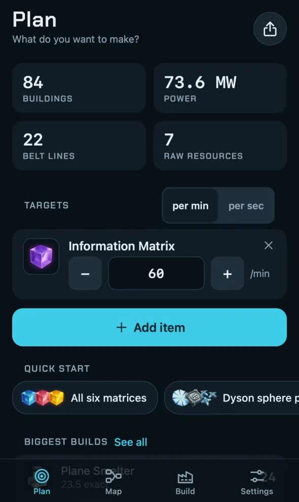
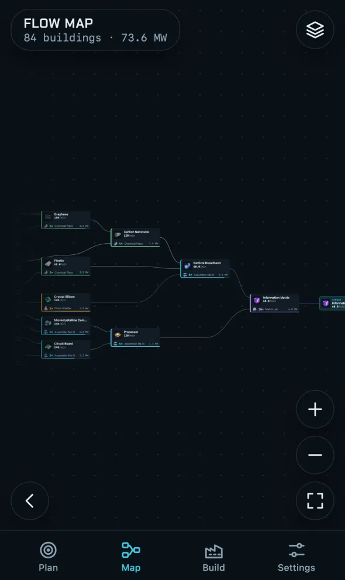
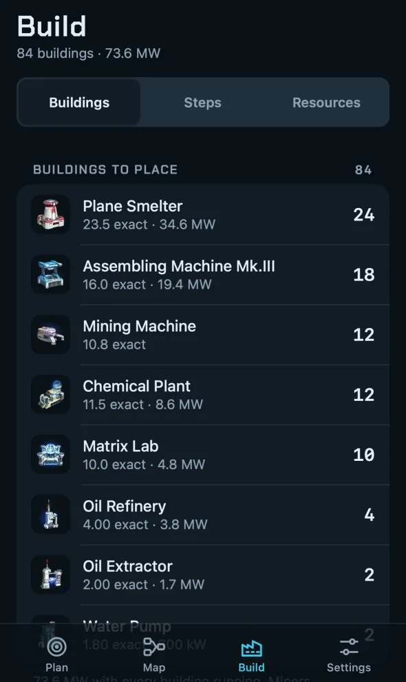
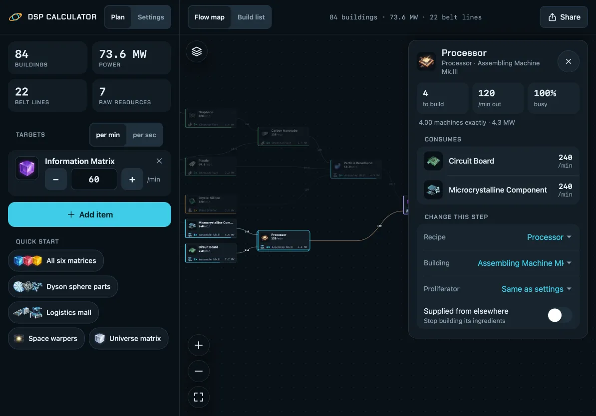

# Dyson Sphere Calculator

A production planner for [Dyson Sphere Program](https://store.steampowered.com/app/1366540/) that works out the steps, buildings, belts and power for the items you want to make.

<p>
  
  
  
</p>
<p>
  
</p>

Open it here: <https://prompt-janitor.github.io/dsp-calculator/>

## Add it to your Home Screen

- **iPhone or iPad:** open the site in Safari, tap Share, then tap **Add to Home Screen**. On iPhone, if you do not see Share, tap the three-dot button first.
- **Android, or Chrome or Edge on a computer:** open the site and choose **Install app** from the browser menu or the address bar.

After that it opens like an app and works offline.

## Using it

1. On the Plan tab, tap **Add item** and pick what you want to make. Set the rate per minute or per second. You can also start from a quick start plan.
2. Open the map to see every production step and how the items flow between them. Tap a step to see its numbers, or to change its recipe, building or proliferator.
3. Open the build list for the buildings to place, the steps, the raw input and the belt lines.
4. In Settings, set your machine tiers, belt tier, proliferator and mining research.
5. To share a plan, use Share. You get a text summary or a plan code that someone else can load.

## Disclaimer

This is an unofficial fan project. It is not affiliated with Youthcat Studio or Gamera Games. Item icons are game art from Dyson Sphere Program by Youthcat Studio, taken from [FactorioLab](https://github.com/factoriolab/factoriolab). The app collects no data. Your plans stay on your device.

AI-generated. May contain errors. Provided as is, without warranty or liability.

## For developers

You need Node 22 or later. The app itself has no dependencies.

```sh
npm ci
npm test            # solver and layout tests
npm run serve       # build, then serve at http://localhost:8080/dsp-calculator/
npm run test:e2e    # Playwright tests on phone, tablet and desktop sizes
```

Pushing to `main` deploys the site to GitHub Pages.

## Licences

- The code is under the MIT licence. See [LICENSE](LICENSE).
- The recipe data comes from [FactorioLab](https://github.com/factoriolab/factoriolab), under the MIT licence.
- The Chakra Petch font is under the SIL Open Font License 1.1.
- The game art belongs to Youthcat Studio.
